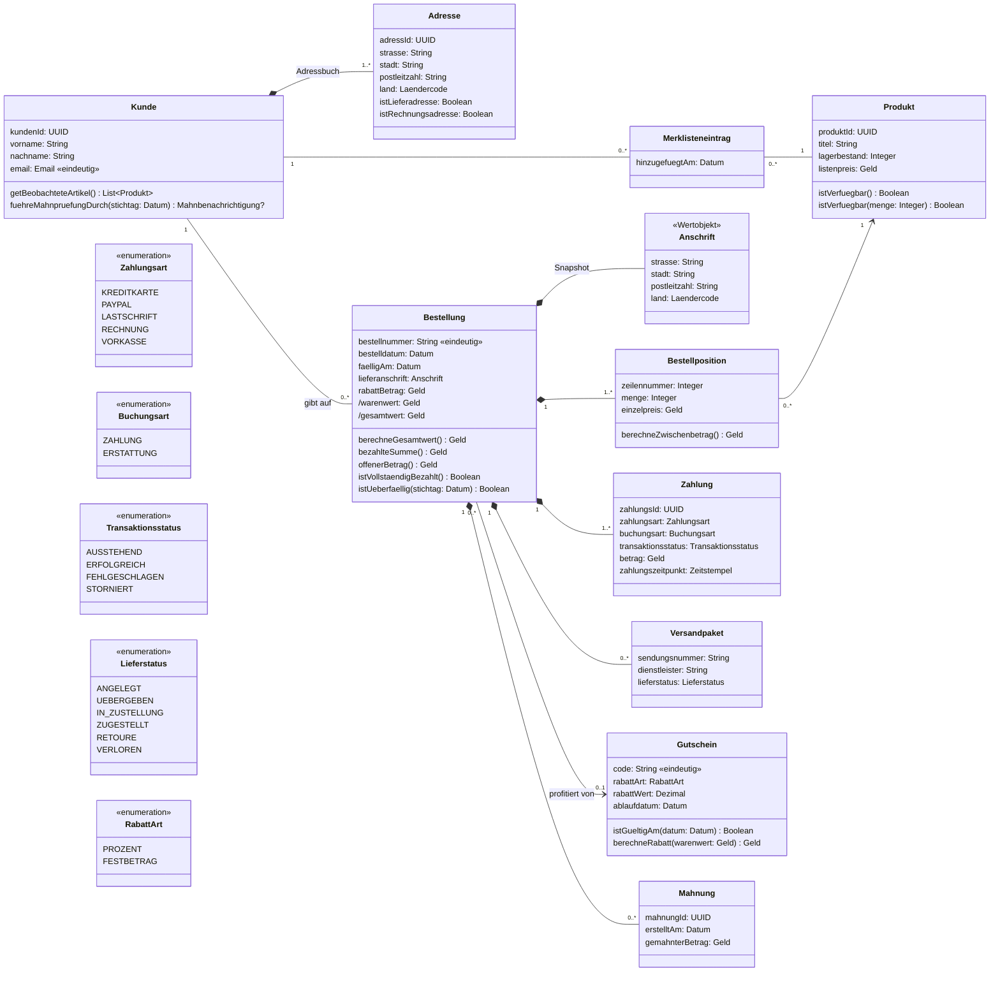

# Domänenmodell

Enthält alle Entscheidungen aus `01-entscheidungen.md`. Abgeleitete Attribute sind mit `/` markiert.

## Klassendiagramm



> `Merklisteneintrag` ist im UML-Sinne die Assoziationsklasse der Beziehung Kunde \*–\* Produkt. Mermaid kennt keine Assoziationsklassen, daher als Zwischenklasse dargestellt.

## Formeln

```
Bestellposition.zwischenbetrag  = menge × einzelpreis
Bestellung.warenwert            = Σ positionen.zwischenbetrag
Bestellung.gesamtwert           = max(0, warenwert − rabattBetrag)
Bestellung.bezahlteSumme        = Σ ERFOLGREICH-ZAHLUNG.betrag − Σ ERFOLGREICH-ERSTATTUNG.betrag
Bestellung.offenerBetrag        = max(0, gesamtwert − bezahlteSumme)
Bestellung.istVollstaendigBezahlt ⇔ bezahlteSumme ≥ gesamtwert
Bestellung.istUeberfaellig(t)   ⇔ offenerBetrag > 0 ∧ t > faelligAm
Gutschein.berechneRabatt(w)     = PROZENT:    round(w × rabattWert / 100)
                                  FESTBETRAG: min(rabattWert, w)
Produkt.istVerfuegbar()         ⇔ lagerbestand > 0
```

## Invarianten

| # | Invariante | Quelle |
|---|---|---|
| I-1 | Kunde hat ≥ 1 Adresse mit `istLieferadresse` | D-06 |
| I-2 | Jede Adresse hat `istLieferadresse ∨ istRechnungsadresse` | D-06 |
| I-3 | E-Mail eindeutig (case-insensitive) | D-13 |
| I-4 | Merklisteneintrag eindeutig je (Kunde, Produkt) | D-07 |
| I-5 | Bestellung hat ≥ 1 Position und ≥ 1 Zahlung | Text, D-02 |
| I-6 | Zeilennummern lückenlos ab 1, Produkt max. einmal je Bestellung | D-10 |
| I-7 | `menge ≥ 1`, `lagerbestand ≥ 0`, alle Beträge ≥ 0 | D-09, D-10, D-05 |
| I-8 | `einzelpreis`, `rabattBetrag`, `lieferanschrift` nach Checkout unveränderlich | D-04, D-08, D-10 |
| I-9 | Gutschein bei Checkout gültig (`bestelldatum ≤ ablaufdatum`) | D-04 |
| I-10 | Gutscheincode eindeutig (case-insensitive) | D-04 |
| I-11 | Sendungsnummer eindeutig je Dienstleister | D-12 |
