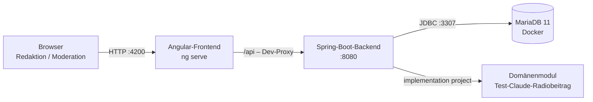
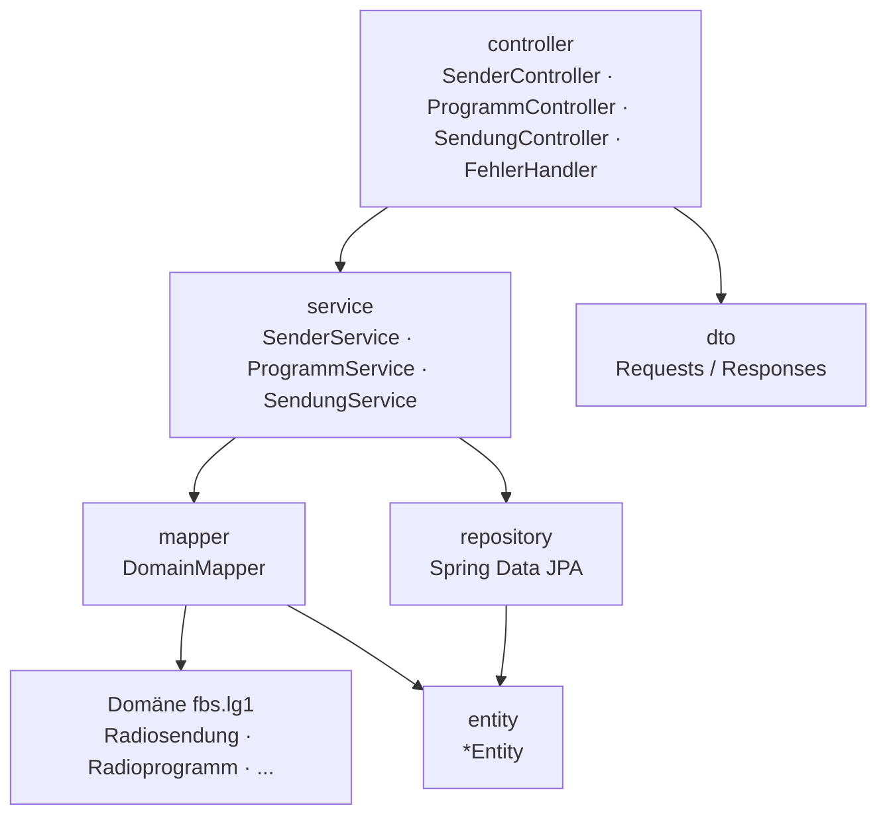
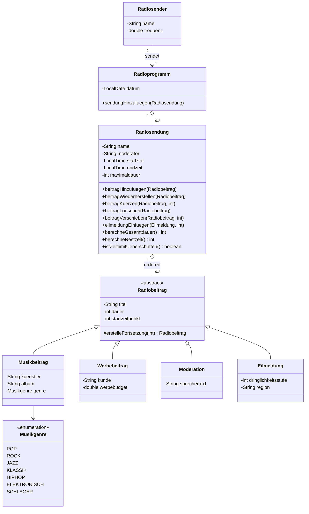
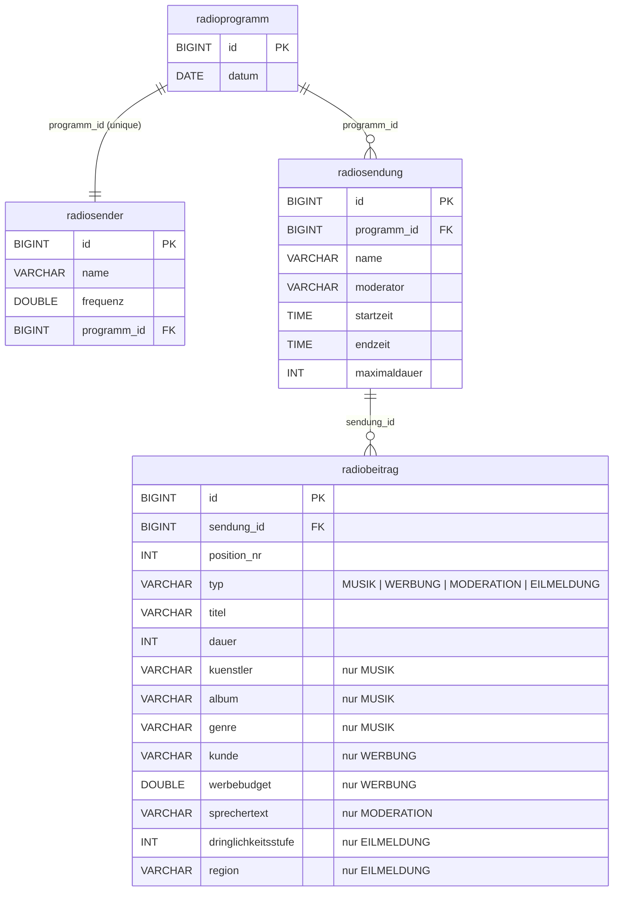
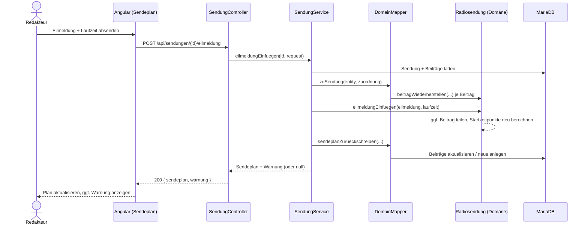
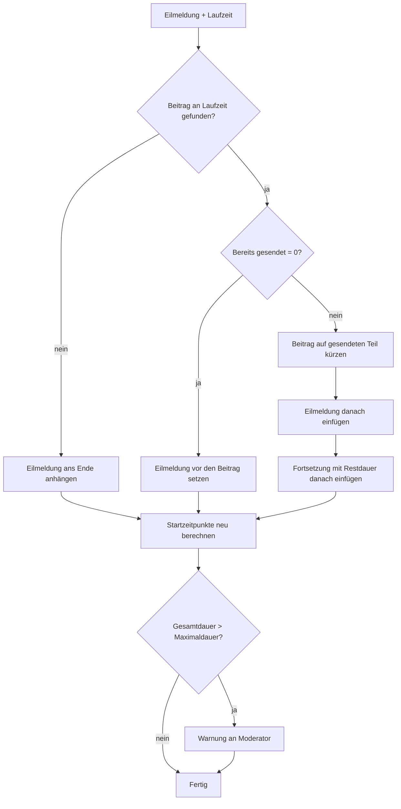

# Test-Claude-Radiobeitrag – Projektdokumentation

Living Documentation für die Sendeplan-Software **Test-Claude-Radiobeitrag** (Domäne `Test-Claude-Radiobeitrag`, Web-App `Test-Claude-RadiobeitragWeb`).
Sie beschreibt den **Ist-Zustand** des Systems. Aufbau nach der Checkliste „Agile Projektdokumentation“, Punkte 1–4.

> Legende: ✅ vorhanden · ⚠️ teilweise · ❌ fehlt noch (Vorschlag)

---

## Inhalt

1. [Vision & Strategie](#1-vision--strategie-das-warum)
2. [Anforderungen & Qualitäts-Framework](#2-anforderungen--qualitäts-framework-das-was)
3. [Technische Dokumentation](#3-technische-dokumentation-das-wie)
4. [Benutzer- & Release-Dokumentation](#4-benutzer---release-dokumentation)

---

## 1. Vision & Strategie (*Das „Warum“*)

### 1.1 Produktvision ✅

> **Für** Redaktionsteams und Moderatoren eines Radiosenders,
> **die** den Tagesablauf ihrer Sendungen sekundengenau planen und bei Eilmeldungen schnell reagieren müssen,
> **ist** Test-Claude-Radiobeitrag eine Sendeplan-Software,
> **die** Sendungen ohne Überschneidungen verwaltet, Startzeitpunkte aller Beiträge automatisch berechnet und Eilmeldungen sofort an der aktuellen Laufstelle einfügt.
> **Anders als** Tabellen oder Papierpläne verhindert sie Planungsfehler (Überschneidungen, überzogene Sendezeit) schon bei der Eingabe und warnt den Moderator, wenn eine Eilmeldung das Zeitlimit sprengt.

**Nutzerkreis**

| Rolle | Ziel |
|---|---|
| Programmplaner/in | Tagesprogramm eines Senders mit Sendungen (Zeitblöcken) aufbauen |
| Redakteur/in | Sendeplan einer Sendung mit Musik, Werbung und Moderation füllen und anpassen |
| Moderator/in | Aktuellen Sendeplan sehen, bei Eilmeldungen gewarnt werden |

**Mehrwert gegenüber dem Ist-Zustand ohne Software**

- Startzeitpunkte werden nie von Hand nachgerechnet – jede Änderung berechnet den ganzen Plan neu.
- Die Maximaldauer einer Sendung kann bei normalen Beiträgen nicht überschritten werden.
- Eilmeldungen teilen einen laufenden Beitrag automatisch in „Teil 1 | Eilmeldung | Fortsetzung“.

### 1.2 Product Goal & Meilensteine ✅

**Product Goal:** *Ein Redaktionsteam kann das Tagesprogramm eines Senders vollständig im Browser planen, Beiträge bearbeiten und Eilmeldungen einfügen – ohne dass eine Fachregel verletzt wird.*

| Meilenstein | Inhalt | Status |
|---|---|---|
| M1 – Domänenmodell | Klassen laut UML (`Radiosender`, `Radioprogramm`, `Radiosendung`, `Radiobeitrag` + 4 Unterklassen), Invarianten, Unit-Tests, Konsolen-Demo (`App.java`) | ✅ fertig |
| M2 – REST-Backend | Spring Boot, JPA-Persistenz in MariaDB, Flyway-Migration, OpenAPI | ✅ fertig |
| M3 – Web-Frontend | Angular-App mit Programmübersicht und Sendeplan-Editor | ✅ fertig |
| M4 – Betrieb & Qualität | Authentifizierung, CI-Pipeline, Deployment, E2E-Tests | ❌ offen |

### 1.3 Produkt-Roadmap (Now / Next / Later) ⚠️

| Now (umgesetzt) | Next | Later |
|---|---|---|
| Sender + Programm anlegen | Login & Rollen (Planer, Moderator) | Mehrere Tage/Programme pro Sender |
| Sendungen ohne Überschneidung | Sendung bearbeiten/löschen | Live-Ansicht mit laufender Uhr („On Air“) |
| Beiträge anhängen, kürzen, verschieben, löschen | CI-Pipeline (Gradle + Vitest) | Export (PDF/CSV) des Sendeplans |
| Eilmeldung mit Split und Warnung | Docker-Image für Backend + Frontend | Benachrichtigung des Moderators (Push) |

> Next/Later sind Vorschläge und noch nicht mit Stakeholdern abgestimmt.

---

## 2. Anforderungen & Qualitäts-Framework (*Das „Was“*)

### 2.1 Product Backlog & User Stories ✅

| ID | User Story | Status |
|---|---|---|
| US-01 | Als **Programmplaner** möchte ich einen **Sender mit Name, Frequenz und Programmdatum anlegen**, um ein Tagesprogramm planen zu können. | ✅ |
| US-02 | Als **Programmplaner** möchte ich **Sendungen mit Zeitblock, Moderator und Maximaldauer anlegen**, um den Tag zu strukturieren. | ✅ |
| US-03 | Als **Programmplaner** möchte ich **alle Sendungen eines Tages nach Startzeit sehen** (Liste + Zeitleiste), um Lücken und Abfolge zu erkennen. | ✅ |
| US-04 | Als **Redakteur** möchte ich **Musik-, Werbe- und Moderationsbeiträge an den Sendeplan anhängen**, um eine Sendung zu füllen. | ✅ |
| US-05 | Als **Redakteur** möchte ich **für jeden Beitrag den Startzeitpunkt, die Gesamtdauer und die Restzeit sehen**, um die Sendezeit im Blick zu behalten. | ✅ |
| US-06 | Als **Redakteur** möchte ich **einen Beitrag kürzen**, um Platz für andere Beiträge zu schaffen. | ✅ |
| US-07 | Als **Redakteur** möchte ich **einen Beitrag verschieben**, um die Reihenfolge zu ändern. | ✅ |
| US-08 | Als **Redakteur** möchte ich **einen Beitrag löschen**, um den Plan zu bereinigen. | ✅ |
| US-09 | Als **Redakteur** möchte ich **eine Eilmeldung an der aktuellen Laufstelle einfügen**, um sofort auf Nachrichten reagieren zu können. | ✅ |
| US-10 | Als **Moderator** möchte ich **gewarnt werden, wenn eine Eilmeldung das Zeitlimit überschreitet**, um meine Moderation anzupassen. | ✅ |
| US-11 | Als **Nutzer** möchte ich **verständliche deutsche Fehlermeldungen sehen**, um falsche Eingaben selbst zu korrigieren. | ✅ |
| US-12 | Als **Betreiber** möchte ich, dass **nur angemeldete Nutzer den Plan ändern**, um Manipulation zu verhindern. | ❌ Backlog |

### 2.2 Akzeptanzkriterien ✅

Die Kriterien entsprechen den Regeln der Domänenklassen und sind durch Tests abgedeckt.

**US-01 – Sender anlegen**
- Name darf nicht leer sein → „Name darf nicht leer sein!“ (400)
- Frequenz > 0 → sonst „Frequenz muss größer als 0 sein!“ (400)
- Datum ist Pflicht → „Datum darf nicht fehlen!“ (400)
- Jeder Sender hat genau ein Radioprogramm (1:1).

**US-02 – Sendung anlegen**
- Name und Moderator dürfen nicht leer sein.
- Endzeit muss nach der Startzeit liegen.
- Maximaldauer > 0 und ≤ Länge des Zeitblocks (in Sekunden).
- Überschneidet sich der Zeitblock mit einer bestehenden Sendung → „Zeitblock überschneidet sich mit einer anderen Sendung!“ (409).
- Sendungen werden automatisch nach Startzeit einsortiert.

**US-04 – Beitrag anhängen**
- Titel nicht leer, Dauer > 0 Sekunden.
- Musik: Künstler, Album, Genre (`POP`, `ROCK`, `JAZZ`, `KLASSIK`, `HIPHOP`, `ELEKTRONISCH`, `SCHLAGER`) Pflicht.
- Werbung: Kunde Pflicht, Werbebudget ≥ 0.
- Moderation: Sprechertext Pflicht.
- Würde die Gesamtdauer die Maximaldauer überschreiten → „Beitrag überschreitet die Maximaldauer der Sendung!“ (409).
- Startzeitpunkt des neuen Beitrags = bisherige Gesamtdauer.

**US-05 – Zeitwerte**
- Startzeitpunkt jedes Beitrags = Summe der Dauern aller vorherigen Beiträge.
- Restzeit = Maximaldauer − Gesamtdauer (negativ, wenn überschritten).
- `zeitlimitUeberschritten = true`, sobald Gesamtdauer > Maximaldauer.

**US-06 – Kürzen**
- Neue Dauer > 0 und < bisherige Dauer, sonst 400.
- Alle nachfolgenden Beiträge rücken nach vorne.

**US-07 – Verschieben**
- Index muss im Bereich `0 … Anzahl−1` liegen → sonst „Index liegt außerhalb des Sendeplans!“ (400).
- Gesamtdauer bleibt gleich, Startzeitpunkte werden neu berechnet.

**US-08 – Löschen**
- Beitrag muss in der Sendung sein, sonst 404/409.
- Nachfolgende Beiträge rücken nach vorne.

**US-09 – Eilmeldung**
- Dringlichkeitsstufe 1–5, Region Pflicht, Laufzeit ≥ 0.
- Laufstelle **am Beginn** eines Beitrags → Eilmeldung wird davor eingefügt.
- Laufstelle **mitten in** einem Beitrag → Beitrag wird geteilt: gesendeter Teil | Eilmeldung | Fortsetzung mit Titelzusatz „(Fortsetzung)“ und Restdauer.
- Laufstelle **nach** dem letzten Beitrag → Eilmeldung wird angehängt.
- Eilmeldungen dürfen die Maximaldauer überschreiten.

**US-10 – Warnung**
- Ist das Zeitlimit nach einer Eilmeldung überschritten, enthält die Antwort `warnung`:
  „WARNUNG an <Moderator>: Sendung '<Name>' überschreitet durch die Eilmeldung ihr Zeitlimit um <n> Sekunden!“
- Das Frontend zeigt die Warnung dauerhaft an, bis sie geschlossen wird.

**US-11 – Fehlermeldungen**
- Jede Fehlerantwort hat den Body `{ "status": <code>, "message": "<deutsche Meldung>" }`.
- Backend nicht erreichbar → Frontend zeigt „Backend nicht erreichbar!“.

### 2.3 Nicht-funktionale Anforderungen (NFRs) ⚠️

| Bereich | Anforderung | Ist-Zustand |
|---|---|---|
| **Performance** | Sendeplan-Abfrage < 200 ms bei ≤ 100 Beiträgen | ⚠️ nicht gemessen; ein Sendeplan wird ohne Joins aus einer Tabelle geladen (`SINGLE_TABLE`) |
| **Skalierbarkeit** | Einzelplatz-/Schulbetrieb, eine Backend-Instanz | ✅ ausreichend; zustandsloses Backend, horizontale Skalierung möglich |
| **Datenintegrität** | Keine Überschneidungen, keine überzogene Sendezeit (außer Eilmeldung) | ✅ Regeln nur in der Domäne, jede Änderung in einer Transaktion (`@Transactional`) |
| **Sicherheit – Authentifizierung** | Nur angemeldete Nutzer dürfen ändern | ❌ keine Authentifizierung (US-12) |
| **Sicherheit – CORS** | Nur das eigene Frontend darf die API aufrufen | ✅ nur `http://localhost:4200`, Methoden `GET/POST/DELETE/OPTIONS` |
| **Sicherheit – Zugangsdaten** | Keine Passwörter im Code | ⚠️ DB-Zugang `lg1/lg1` steht in `application.yml` und `docker-compose.yml` – nur für lokale Entwicklung zulässig |
| **Datenschutz (DSGVO)** | Möglichst wenig personenbezogene Daten | ✅ nur Moderatorname und Kundenname; keine Nutzerkonten |
| **Verschlüsselung** | HTTPS im Betrieb | ❌ lokal nur HTTP |
| **Barrierefreiheit** | Bedienbar mit Tastatur, semantisches HTML, deutsche Texte | ⚠️ native Formulare/Buttons; kein Audit (z. B. axe/Lighthouse) durchgeführt |
| **Kompatibilität** | Aktuelle Versionen von Chrome, Firefox, Edge, Safari | ⚠️ durch Angular 21 unterstützt, nicht manuell getestet |
| **Wartbarkeit** | Business-Regeln nur an einer Stelle | ✅ Domäne als eigenes Gradle-Modul, Backend ruft nur Domänenmethoden auf |
| **Lokalisierung** | Oberfläche und Fehlermeldungen auf Deutsch | ✅ |

### 2.4 Definition of Ready (DoR) ✅

Eine Story darf in den Sprint, wenn:

- [ ] Sie im Schema „Als … möchte ich … um …“ formuliert ist.
- [ ] Akzeptanzkriterien inkl. Fehlermeldungen (deutscher Text, HTTP-Status) feststehen.
- [ ] Betroffene Klassen im UML-Diagramm (`Test-Claude-Radiobeitrag/uml.puml`) eingezeichnet sind oder die Änderung am UML beschrieben ist.
- [ ] Bei neuen Endpunkten: Pfad, Methode, Request- und Response-Body sind skizziert.
- [ ] Bei UI-Änderungen: grobe Skizze/Wireframe liegt vor.
- [ ] Die Story ist geschätzt und passt in einen Sprint.

### 2.5 Definition of Done (DoD) ✅

Ein Inkrement ist fertig, wenn:

- [ ] Code-Review von mindestens einer weiteren Person durchgeführt wurde.
- [ ] Code die Projekt-Regeln aus `CLAUDE.md` einhält (englische Namen, keine `get/set`, deutsche Ausgaben, Javadoc auf Deutsch).
- [ ] Unit-Tests (Domäne), Service- und Controller-Tests (Backend) und Vitest-Tests (Frontend) geschrieben sind.
- [ ] `./gradlew checkAllTasks` grün ist.
- [ ] `npx ng test --watch=false` im Frontend grün ist.
- [ ] Flyway-Migration für jede Schemaänderung angelegt ist (nie bestehende Migration ändern).
- [ ] README, diese Dokumentation und die OpenAPI-Beschreibungen (`@Schema`) aktualisiert sind.
- [ ] Akzeptanzkriterien lokal mit MariaDB + Frontend manuell geprüft wurden.

---

## 3. Technische Dokumentation (*Das „Wie“*)

### 3.1 Systemarchitektur ✅

#### Systemkontext



#### Module

| Modul | Pfad | Technologie | Aufgabe |
|---|---|---|---|
| Domäne | `Test-Claude-Radiobeitrag/` | Java 21, JUnit 5, AssertJ | Fachklassen und alle Business-Regeln, Konsolen-Demo `App.java` |
| Backend | `Test-Claude-RadiobeitragWeb/backend/` | Spring Boot 4.1, Spring Data JPA, Flyway, springdoc-openapi | REST-API, Persistenz, Abbildung Domäne ↔ Datenbank |
| Frontend | `Test-Claude-RadiobeitragWeb/frontend/` | Angular 21 (Standalone Components, Signals), Vitest | Web-Oberfläche |
| Datenbank | `docker-compose.yml` (Repo-Root) | MariaDB 11 | Speicherung |

#### Schichten im Backend (`fbs.lg1.web`)



| Paket | Inhalt |
|---|---|
| `controller` | REST-Endpunkte; `FehlerHandler` übersetzt Ausnahmen in HTTP-Status |
| `service` | Ablauf pro Anwendungsfall, Transaktionen, `NichtGefundenException` |
| `mapper` | `DomainMapper`: Entity → Domäne, Domäne → Entity, Domäne → DTO |
| `entity` | JPA-Entities, Vererbung `SINGLE_TABLE` für Beiträge |
| `repository` | `RadiosenderRepository`, `RadioprogrammRepository`, `RadiosendungRepository` |
| `dto` | Java-Records für Requests/Responses mit `@Schema`-Beschreibungen |
| `config` | `CorsConfig`, `OpenApiConfig` |

#### Frontend (`frontend/src/app`)

| Ordner | Inhalt |
|---|---|
| `pages/programm-uebersicht` | Sender anlegen, Sendungen anlegen, Liste + Zeitleiste (Route `/`) |
| `pages/sendeplan` | Sendeplan einer Sendung: kürzen, verschieben, löschen, Eilmeldung (Route `/sendungen/:id`) |
| `components/beitrag-formular` | Formular für Musik-, Werbe- und Moderationsbeiträge |
| `components/eilmeldung-formular` | Formular für Eilmeldung mit Laufzeit |
| `components/meldungen` | Toast-Anzeige für Erfolg, Fehler, Warnung |
| `services` | `SenderService`, `ProgrammService`, `SendungService` (HTTP), `MeldungService` (Signals) |
| `models/api.models.ts` | TypeScript-Typen der REST-DTOs |
| `shared/zeit.ts` | Umrechnung Sekunden ↔ `mm:ss` / Uhrzeit |

#### Klassendiagramm der Domäne

Quelle: [`Test-Claude-Radiobeitrag/uml.puml`](../Test-Claude-Radiobeitrag/uml.puml) (PlantUML, maßgeblich). Vereinfachte Übersicht:



Alle Zeiten innerhalb einer Sendung sind **Sekunden**. Jede Klasse prüft ihre Regeln im Konstruktor (`IllegalArgumentException`) und nach jeder Änderung in `checkInvariant()` (`IllegalStateException`).

#### Datenmodell (ERD)

Quelle: `backend/src/main/resources/db/migration/V1__init.sql`



- `position_nr` speichert die Reihenfolge (`@OrderColumn`).
- `startzeitpunkt` wird **nicht** gespeichert, sondern von der Domäne berechnet.

#### Sequenzdiagramm: Eilmeldung einfügen



#### Aktivitätsdiagramm: Position der Eilmeldung



### 3.2 API-Dokumentation ✅

Die API-Spezifikation wird **automatisch** aus dem Code erzeugt (springdoc-openapi). Die DTOs sind mit `@Schema` beschrieben.

| Ressource | URL (Backend läuft) |
|---|---|
| Swagger UI | <http://localhost:8080/swagger-ui.html> |
| OpenAPI JSON | <http://localhost:8080/v3/api-docs> |

> Hinweis: Der Ansatz ist **Code-First**, nicht Contract-First. Die OpenAPI-Datei wird aus den Controllern erzeugt und nicht vorab geschrieben.

#### Endpunkte

| Methode | Pfad | Zweck | Erfolg | Fehler |
|---|---|---|---|---|
| POST | `/api/sender` | Sender mit Programm anlegen | 201 | 400 |
| GET | `/api/sender` | Alle Sender | 200 | – |
| GET | `/api/sender/{id}` | Ein Sender | 200 | 404 |
| GET | `/api/programme/{id}` | Programm mit Sendungen | 200 | 404 |
| GET | `/api/programme/{id}/sendungen` | Sendungen nach Startzeit | 200 | 404 |
| POST | `/api/programme/{id}/sendungen` | Sendung anlegen | 201 | 400, 404, 409 |
| GET | `/api/sendungen/{id}` | Sendeplan mit Startzeitpunkten, Gesamtdauer, Restzeit, `zeitlimitUeberschritten` | 200 | 404 |
| POST | `/api/sendungen/{id}/beitraege` | Beitrag anhängen (`typ`: `MUSIK`, `WERBUNG`, `MODERATION`, `EILMELDUNG`) | 201 | 400, 404, 409 |
| POST | `/api/sendungen/{id}/beitraege/{beitragId}/kuerzen` | `{ "neueDauer": 180 }` | 200 | 400, 404 |
| POST | `/api/sendungen/{id}/beitraege/{beitragId}/verschieben` | `{ "neuerIndex": 0 }` | 200 | 400, 404 |
| DELETE | `/api/sendungen/{id}/beitraege/{beitragId}` | Beitrag löschen | 200 | 404 |
| POST | `/api/sendungen/{id}/eilmeldung` | Eilmeldung an `laufzeit` einfügen, Antwort enthält `warnung` | 200 | 400, 404 |

> Genaue Statuscodes und Bodies: siehe Swagger UI – sie ist die maßgebliche Quelle.

#### Fehlerformat

| Ausnahme | HTTP-Status |
|---|---|
| `IllegalArgumentException` (ungültige Eingabe) | 400 |
| `HttpMessageNotReadableException` (kaputtes JSON, unbekannter `typ`) | 400 – „Anfrage ist ungültig oder unvollständig!“ |
| `MethodArgumentTypeMismatchException` (z. B. ID keine Zahl) | 400 – „Parameter '<name>' ist ungültig!“ |
| `NichtGefundenException` | 404 |
| `IllegalStateException` (Regelverstoß im aktuellen Zustand) | 409 |

```json
{ "status": 409, "message": "Beitrag überschreitet die Maximaldauer der Sendung!" }
```

#### Beispiel: Beitrag anhängen

```http
POST /api/sendungen/1/beitraege
Content-Type: application/json

{
  "typ": "MUSIK",
  "titel": "Morgenlied",
  "dauer": 210,
  "kuenstler": "Marcel Schachner",
  "album": "Frühstück",
  "genre": "POP"
}
```

### 3.3 Architekturentscheidungen (ADRs) ✅

#### ADR-001: Domäne als eigenes Gradle-Modul wiederverwenden

- **Kontext:** Die Fachlogik existiert bereits als getestete Aufgabe (`Test-Claude-Radiobeitrag`) laut UML.
- **Optionen:** (a) Regeln im Backend neu schreiben, (b) Domänenmodul per `implementation project(':Test-Claude-Radiobeitrag')` einbinden.
- **Entscheidung:** (b).
- **Begründung:** Eine einzige Quelle für Business-Regeln, Domänentests bleiben gültig, UML bleibt Spezifikation.
- **Konsequenzen:** Domänenklassen sind keine JPA-Entities → eigener `DomainMapper` und eigene Entity-Klassen nötig.

#### ADR-002: Getrennte Entities statt annotierter Domänenklassen

- **Kontext:** JPA braucht Standardkonstruktor, veränderbare Felder und IDs; die Domäne hat `final`-Felder und prüft Invarianten.
- **Entscheidung:** Eigene `*Entity`-Klassen im Paket `entity`, Umwandlung über `DomainMapper`.
- **Konsequenzen:** Mehr Code, aber die Domäne bleibt frei von Framework-Abhängigkeiten. Jeder Request lädt Entities → baut Domäne → ruft Domänenmethode → schreibt zurück.

#### ADR-003: Vererbung der Beiträge mit `SINGLE_TABLE`

- **Kontext:** Vier Beitragstypen mit wenigen Zusatzfeldern; ein Sendeplan wird immer komplett und polymorph geladen.
- **Optionen:** `SINGLE_TABLE`, `JOINED`, `TABLE_PER_CLASS`.
- **Entscheidung:** `SINGLE_TABLE` mit Diskriminator-Spalte `typ`.
- **Begründung:** Eine Abfrage ohne Joins, einfache Reihenfolge über `position_nr`.
- **Konsequenzen:** Typspezifische Spalten sind `NULL`-fähig; Pflichtfelder prüft die Domäne, nicht die Datenbank.

#### ADR-004: Startzeitpunkt wird nicht gespeichert

- **Kontext:** Der Startzeitpunkt ergibt sich vollständig aus Reihenfolge und Dauer.
- **Entscheidung:** Nur `position_nr` und `dauer` speichern, Startzeitpunkt berechnet `Radiosendung`.
- **Konsequenzen:** Keine inkonsistenten Daten möglich; Berechnung bei jedem Laden (vernachlässigbarer Aufwand).

#### ADR-005: `beitragWiederherstellen()` für den Wiederaufbau

- **Kontext:** Nach einer Eilmeldung darf ein gespeicherter Sendeplan über der Maximaldauer liegen. `beitragHinzufuegen()` würde ihn beim Laden ablehnen.
- **Entscheidung:** Methode `Radiosendung.beitragWiederherstellen()` ohne Limitprüfung (im UML ergänzt).
- **Konsequenzen:** Nur der Mapper darf sie benutzen; neue Beiträge laufen immer über `beitragHinzufuegen()`.

#### ADR-006: Neue Fortsetzungsbeiträge per `IdentityHashMap` erkennen

- **Kontext:** Beim Split einer Eilmeldung entsteht in der Domäne ein neues Objekt (Fortsetzung) ohne Datenbank-ID.
- **Entscheidung:** Der Mapper merkt sich die Zuordnung Domänenobjekt → Entity in einer `IdentityHashMap`. Objekte ohne Zuordnung werden als neue Entity angelegt, fehlende gelöscht.
- **Konsequenzen:** Vergleich über Objektidentität, unabhängig von `equals()`.

#### ADR-007: Schemaverwaltung mit Flyway, `ddl-auto: validate`

- **Kontext:** Gemeinsame Datenbank `lg1` mit anderen Aufgaben.
- **Entscheidung:** Flyway-Migrationen (`db/migration`), Hibernate prüft nur (`validate`), `baseline-on-migrate: true`.
- **Konsequenzen:** Schemaänderungen nur über neue Migration `V2__...sql`; fremde Tabellen bleiben unberührt.

#### ADR-008: Ausnahmen der Domäne direkt auf HTTP-Status abbilden

- **Kontext:** Die Domäne liefert bereits deutsche Meldungen.
- **Entscheidung:** Zentrale `@RestControllerAdvice` (`FehlerHandler`): `IllegalArgumentException` → 400, `IllegalStateException` → 409, `NichtGefundenException` → 404.
- **Konsequenzen:** Keine doppelte Validierung im Controller; Frontend zeigt `message` direkt an.

#### ADR-009: Tests ohne MariaDB (H2)

- **Kontext:** `./gradlew checkAllTasks` soll überall ohne Docker laufen.
- **Entscheidung:** Backend-Tests mit H2 im Speicher.
- **Konsequenzen:** Schnelle Tests; MariaDB-spezifisches Verhalten wird nur manuell geprüft.

#### ADR-010: Angular mit Standalone Components, Signals und Dev-Proxy

- **Kontext:** Kleine Single-Page-App mit zwei Seiten.
- **Entscheidung:** Angular 21 ohne NgModules, Zustand in Signals, `proxy.conf.json` leitet `/api` an `:8080`.
- **Konsequenzen:** Keine CORS-Probleme in der Entwicklung; für Produktion ist zusätzlich `CorsConfig` bzw. ein Reverse Proxy nötig.

### 3.4 Developer Working Agreement & Repository-Regeln ⚠️

#### Branching-Modell ❌ (Vorschlag)

Aktuell wird direkt auf `main` gearbeitet. Vorschlag:

- `main` ist immer lauffähig (`checkAllTasks` grün).
- Feature-Branches: `feature/<aufgabe>-<kurzbeschreibung>`, z. B. `feature/radiobeitrag-login`.
- Bugfix-Branches: `fix/<kurzbeschreibung>`.
- Merge per Pull Request, danach Branch löschen.

#### Pull-Request-Richtlinien ❌ (Vorschlag)

- Titel im Format `<Aufgabe>: <Beschreibung>` (wie bestehende Commits, z. B. `Aufgabe26: Radiosendung`).
- Beschreibung: Was/Warum, betroffene User Story, Screenshots bei UI-Änderungen.
- Mindestens ein Review, alle DoD-Punkte erfüllt.

#### Coding Standards ✅

Verbindlich in [`CLAUDE.md`](../CLAUDE.md). Wichtigste Punkte für die Domäne:

- Namen auf Englisch, Konsolenausgaben und Fehlermeldungen auf Deutsch, Meldungen enden mit `!`.
- Keine `get`/`set`-Methoden → `showX()`, `istX()`, `checkX()`.
- Keine Streams, Lambdas (außer in Tests), Ternary, `var`, `Optional`, `this(...)`.
- Konstruktor: Parameter prüfen → Felder setzen → `checkInvariant()`.
- Zustandsändernde Methoden: `IllegalStateException` bei falschem Zustand, `assert` für Nachbedingungen, `checkInvariant()` am Ende.
- Javadoc (Deutsch) auf jeder Klasse und öffentlichen Methode, sonst keine Kommentare.
- Tests nur mit AssertJ, Setup in `@BeforeEach prepare()`, Namen `testInit`, `testXxx`.
- Testpersonen: `Marcel Schachner` / `schachner.marcel@icloud.com`, ggf. `Max Mustermann` / `max.mustermann@gmail.com`.

Frontend: Prettier ist als Formatter eingebunden (`devDependencies`).

### 3.5 README-Dateien ✅

| Datei | Inhalt |
|---|---|
| [`README.md`](README.md) | Voraussetzungen, DB/Backend/Frontend starten, Tests, Endpunkte, Architektur-Kurzfassung |
| [`frontend/README.md`](frontend/README.md) | Standard-Angular-CLI-README |
| [`../README.md`](../README.md) | Gesamt-Repository |

#### Schnellstart (Kurzfassung)

Voraussetzungen: Java 21, Docker, Node.js ≥ 22.12.

```bash
# 1. Datenbank (Repo-Root)
docker compose up -d mariadb

# 2. Backend (Repo-Root)
./gradlew :Test-Claude-RadiobeitragWeb:backend:bootRun

# 3. Frontend
cd Test-Claude-RadiobeitragWeb/frontend
npm install
npm start
```

App: <http://localhost:4200> · API: <http://localhost:8080/api> · Swagger: <http://localhost:8080/swagger-ui.html>

Nur die Konsolen-Demo der Domäne: `./run.sh` → `Test-Claude-Radiobeitrag` → „Programm starten“.

#### Tests

```bash
./gradlew checkAllTasks                                         # alle Gradle-Tests (Domäne + Backend)
./gradlew :Test-Claude-Radiobeitrag:test                        # nur Domäne
./gradlew :Test-Claude-RadiobeitragWeb:backend:test             # nur Backend (H2)
cd Test-Claude-RadiobeitragWeb/frontend && npx ng test --watch=false   # Frontend (Vitest)
```

| Bereich | Testklassen | Anzahl Tests |
|---|---|---|
| Domäne | `RadiosenderTest`, `RadioprogrammTest`, `RadiosendungTest`, `MusikbeitragTest`, `WerbebeitragTest`, `ModerationTest`, `EilmeldungTest` | 40 |
| Backend – Service | `SenderServiceTest`, `ProgrammServiceTest`, `SendungServiceTest` | 20 |
| Backend – Controller | `SenderControllerTest`, `ProgrammControllerTest`, `SendungControllerTest` | 19 |
| Backend – Integration | `AblaufIntegrationTest` | 2 |
| Frontend | 7 `*.spec.ts`-Dateien | 26 |

#### Konfiguration

| Datei | Wichtige Werte |
|---|---|
| `backend/src/main/resources/application.yml` | DB `jdbc:mariadb://localhost:3307/lg1`, User/Passwort `lg1`, Port 8080, Flyway an |
| `../docker-compose.yml` | Container `lg1-mariadb`, Port `3307:3306`, Volume `mariadb-data` |
| `frontend/proxy.conf.json` | `/api` → `http://localhost:8080` |

### 3.6 Onboarding-Guide (Optional) ✅

**Tag 1 – Verstehen**

1. Diese Dokumentation lesen (Kapitel 1 und 3.1).
2. UML `Test-Claude-Radiobeitrag/uml.puml` ansehen (PlantUML-Plugin in der IDE).
3. `CLAUDE.md` (Code-Regeln) lesen.
4. Konsolen-Demo starten: `./run.sh` → `Test-Claude-Radiobeitrag`.

**Tag 1 – Aufsetzen**

1. Repository klonen, Java 21, Docker, Node.js installieren.
2. Schnellstart aus 3.5 durchführen, App im Browser öffnen.
3. `./gradlew checkAllTasks` und Frontend-Tests ausführen – alles muss grün sein.

**Tag 2 – Erster Beitrag**

1. In der App: Sender anlegen → Sendung anlegen → Beiträge anhängen → Eilmeldung mitten in einen Beitrag setzen.
2. Den Ablauf im Code nachverfolgen: `SendungController` → `SendungService.eilmeldungEinfuegen` → `Radiosendung.eilmeldungEinfuegen`.
3. Eine kleine Story aus dem Backlog nehmen, DoR prüfen, umsetzen, DoD prüfen, PR öffnen.

**Wo finde ich was?**

| Frage | Ort |
|---|---|
| Welche Regel gilt? | Domänenklassen in `Test-Claude-Radiobeitrag/src/main/java/fbs/lg1/` |
| Wie heißt der Endpunkt? | Swagger UI oder Tabelle in 3.2 |
| Wie sieht die Tabelle aus? | `V1__init.sql` |
| Warum ist das so gebaut? | ADRs in 3.3 |

---

## 4. Benutzer- & Release-Dokumentation

### 4.1 Release Notes / Changelog ✅

Format nach [Keep a Changelog](https://keepachangelog.com/de/).

#### [0.3.0] – 2026-11-09 – Umbenennung

**Geändert**
- Projekte umbenannt: `AUFGABETest` → `Test-Claude-Radiobeitrag`, `AUFGABETestWeb` → `Test-Claude-RadiobeitragWeb`.
- Anzeigename „AirControl 2026“ → „Test-Claude-Radiobeitrag“ (Browser-Titel, Kopfzeile, API-Titel, Spring-Anwendungsname).

#### [0.2.0] – Web-Applikation

**Neu**
- REST-API für Sender, Programme, Sendungen und Beiträge (Spring Boot, MariaDB, Flyway).
- Swagger UI unter `/swagger-ui.html`.
- Angular-Oberfläche: Programmübersicht mit Zeitleiste, Sendeplan-Editor (kürzen, verschieben, löschen), Eilmeldung mit Warnung.
- Einheitliche deutsche Fehlermeldungen (400/404/409).

**Mehrwert:** Das Team plant jetzt im Browser statt über die Konsolen-Demo; Daten bleiben gespeichert.

#### [0.1.0] – Domänenmodell

**Neu**
- Klassen laut UML inkl. Invarianten und 40 Unit-Tests.
- Eilmeldung teilt laufende Beiträge automatisch.
- Konsolen-Demo `App.java`.

### 4.2 Benutzerhandbuch (Optional) ✅

#### Programmübersicht (Startseite `/`)

1. **Sender anlegen:** Name, Frequenz (z. B. `98.5`) und Datum eingeben → „Sender anlegen“. Dabei wird das Tagesprogramm erzeugt.
2. **Sendung anlegen:** Name, Moderator, Start- und Endzeit sowie Maximaldauer eingeben → „Sendung anlegen“.
   - Die Maximaldauer darf nicht länger als der Zeitblock sein.
   - Überschneidet sich die Sendung mit einer anderen, erscheint eine Fehlermeldung.
3. **Zeitleiste** und **Sendungsliste** zeigen alle Sendungen des Tages; ein Klick auf eine Sendung öffnet ihren Sendeplan („← Programmübersicht“ führt zurück).

#### Sendeplan (`/sendungen/:id`)

- Oben stehen **Gesamtdauer**, **Restzeit** und ein Hinweis, wenn das Zeitlimit überschritten ist.
- **Beitrag hinzufügen:** Typ wählen (Musik, Werbung, Moderation), Felder ausfüllen. Passt der Beitrag nicht mehr in die Maximaldauer, wird er abgelehnt.
- **↑ / ↓:** Beitrag eine Position nach oben/unten verschieben.
- **Kürzen:** neue, kürzere Dauer eingeben und mit „OK“ bestätigen (× bricht ab).
- **Löschen:** Beitrag entfernen; alle folgenden Beiträge rücken nach vorne.
- **Eilmeldung einfügen:** Titel, Dauer, Dringlichkeit (1–5), Region und **Laufzeit** (Sekunden seit Sendungsbeginn) eingeben.
  Läuft an dieser Stelle gerade ein Beitrag, wird er geteilt („… (Fortsetzung)“).
  Überschreitet die Sendung danach ihr Zeitlimit, erscheint eine **Warnung an den Moderator**, die bis zum Schließen sichtbar bleibt.

#### Meldungen

| Farbe/Art | Bedeutung | Anzeigedauer |
|---|---|---|
| Erfolg | Aktion gespeichert | 4 s |
| Fehler | Eingabe ungültig oder Regel verletzt (Text vom Server) | 8 s |
| Warnung | Zeitlimit durch Eilmeldung überschritten | bis zum Schließen |

#### FAQ

| Frage | Antwort |
|---|---|
| „Backend nicht erreichbar!“ | Backend (`bootRun`) und Datenbank (`docker compose up -d mariadb`) starten. |
| Warum kann ich keinen Beitrag mehr hinzufügen? | Die Restzeit reicht nicht. Einen Beitrag kürzen oder löschen. |
| Warum darf die Eilmeldung das Limit überschreiten? | Eilmeldungen haben Vorrang; der Moderator wird gewarnt und muss selbst kürzen. |
| Wie lösche ich eine Sendung oder einen Sender? | Noch nicht möglich (siehe Roadmap „Next“). |

### 4.3 Abnahmeprotokoll ❌

Nicht regulatorisch oder vertraglich gefordert. Bei Bedarf (z. B. Abgabe im Unterricht) Vorlage:

| Nr. | Prüfpunkt (User Story) | Erwartet | Ergebnis | OK |
|---|---|---|---|---|
| 1 | US-01 Sender anlegen | Sender + Programm sichtbar | | ☐ |
| 2 | US-02 Überschneidende Sendung | Fehler 409 mit Meldung | | ☐ |
| 3 | US-04 Beitrag über Maximaldauer | Fehler 409 mit Meldung | | ☐ |
| 4 | US-09 Eilmeldung mitten im Beitrag | Teil 1 · Eilmeldung · Fortsetzung | | ☐ |
| 5 | US-10 Eilmeldung über Limit | Warnung an Moderator | | ☐ |

Abnahme durch: ____________________ Datum: __________ Unterschrift: __________

---

*Diese Dokumentation beschreibt den Stand vom 2026-11-09. Veraltete Abschnitte bei jeder Änderung anpassen oder entfernen.*
