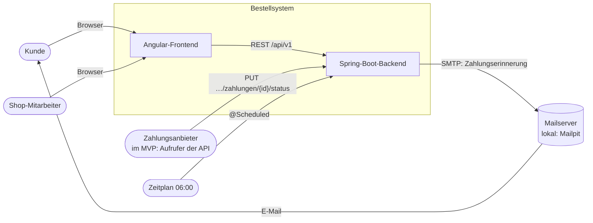
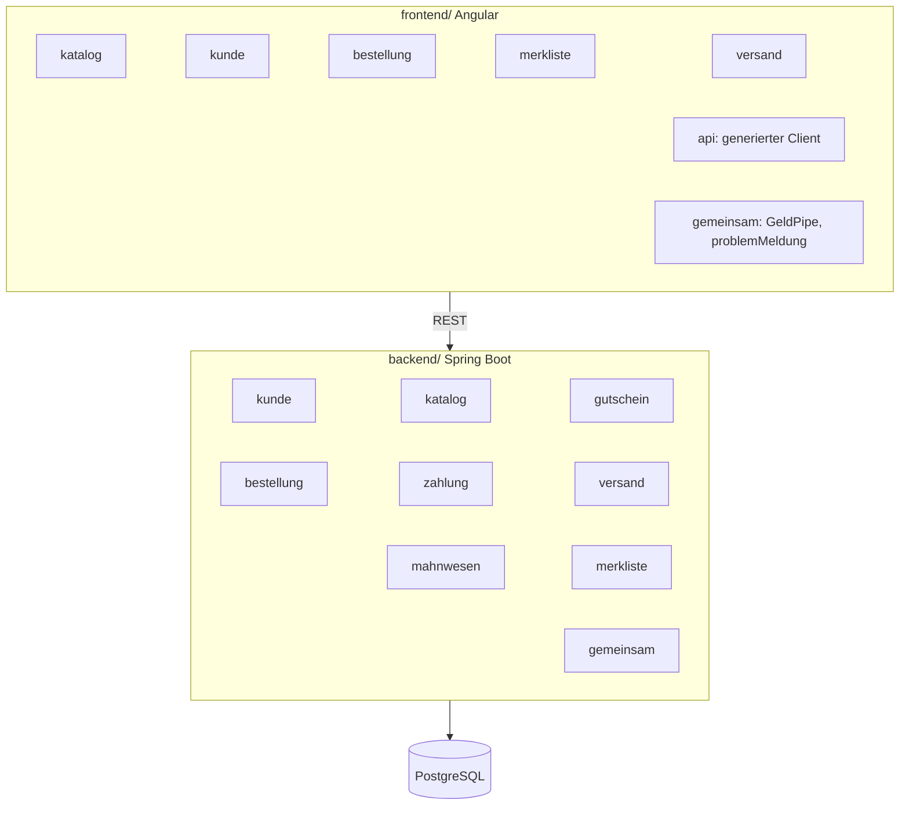
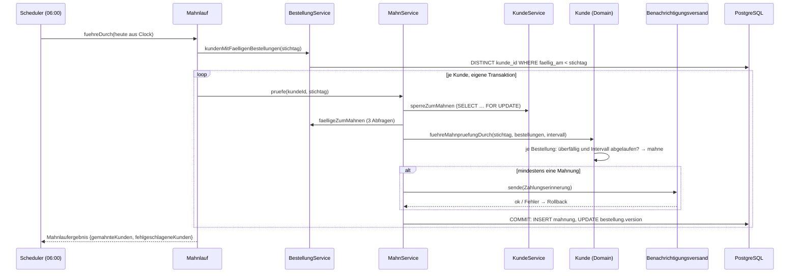
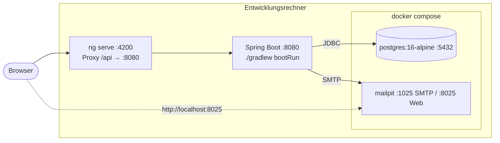

# Architekturdokumentation nach arc42

Stand: Abschluss MVP (Schritt 9, 2026-11-12). Detailtabellen (alle Pakete, Endpunkte, Tabellen, Migrationen, Tests) stehen in [ARCHITEKTUR.md](ARCHITEKTUR.md); dieses Dokument gibt den Überblick und begründet ihn.

## 1 Einführung und Ziele

Ein Onlineshop stellt sein Bestellsystem neu auf ([Anforderung](00-anforderung.md)). Das MVP deckt ab:

| Fachgebiet | Epic | Kern |
|---|---|---|
| Kundenkonto, Adressbuch | E01 | Registrierung mit Lieferadresse, mindestens eine Lieferadresse (I-1) |
| Katalog, Lagerbestand | E02 | Produkt anlegen, Verfügbarkeit prüfen |
| Merkliste | E03 | Produkte merken und entfernen, Merkdatum |
| Bestellung, Checkout | E04 | Bestellung in einer Transaktion, Lieferadress-Snapshot, eingefrorene Preise |
| Zahlungen | E05 | Bezahlstatus, offener Betrag, Erstattungen |
| Mahnwesen | E06 | Mahnprüfung je Kunde, täglicher Mahnlauf, E-Mail |
| Versand | E07 | Pakete mit Sendungsnummer und Lieferstatus |
| Gutscheine | E08 | Prozent- oder Festbetragsrabatt, eingefroren in der Bestellung |

### Qualitätsziele

| Priorität | Ziel | Maßnahme |
|---|---|---|
| 1 | **Korrektheit von Geld und Bestand** | Cent als `long` (ADR 0006), Bestand nie negativ auch bei gleichzeitigen Checkouts (ADR 0003) |
| 2 | **Nachvollziehbarkeit** | Eingefrorene Preise, Rabatte, Lieferanschrift; abgeleitete Werte nur berechnet ([D-01](01-entscheidungen.md#d-01-gesamtwert-gespeichert-oder-berechnet), [D-08](01-entscheidungen.md#d-08-lieferadress-snapshot)) |
| 3 | **Testbarkeit** | Fachlogik ohne Spring testbar, feste Uhr (ADR 0009), echtes PostgreSQL in Tests (ADR 0005) |
| 4 | **Änderbarkeit** | Pakete nach Fachlichkeit (ADR 0004), Frontend ohne Fachlogik (ADR 0010) |

### Stakeholder

| Rolle | Erwartung |
|---|---|
| Kunde | bestellt, sieht Bezahl- und Versandstatus, erhält Mahnungen nur bei echtem Rückstand |
| Shop-Mitarbeiter | pflegt Katalog, Bestand, Versandpakete; löst Mahnlauf bei Bedarf aus |
| Entwicklung | eindeutige fachliche Regeln (`D-xx`), Akzeptanzkriterien als Tests |

## 2 Randbedingungen

- Java 21, Spring Boot 3.5, Gradle 9 (Wrapper, ADR 0001); Angular 21; PostgreSQL 16.
- Kein Login im MVP: kundenbezogene Pfade tragen die Kunden-ID.
- Nicht im Umfang: Storno, Versandkosten, Steuern, Rechnungsadresse in der Bestellung, Mahnstufen und Gebühren, Gutschein-Nutzungslimits, echte Zahlungsanbieter, Tracking-APIs.
- Fachliche Lücken werden als `D-xx` in [01-entscheidungen.md](01-entscheidungen.md) entschieden, bevor Code entsteht.

## 3 Kontextabgrenzung



| Nachbar | Schnittstelle | Inhalt |
|---|---|---|
| Browser | HTTPS, Angular-SPA | Katalog, Kunden, Warenkorb, Bestellungen, Merkliste, Versand |
| Frontend → Backend | REST/JSON unter `/api/v1`, [OpenAPI](api/openapi.yaml) | alle Fachoperationen; Fehler als ProblemDetail |
| Zahlungsanbieter | `PUT …/zahlungen/{id}/status`, `POST …/erstattungen` | meldet Erfolg oder Fehlschlag einer Buchung ([D-19](01-entscheidungen.md#d-19-zahlungsstatus-ändern-und-erstattung-buchen)); im MVP ohne echte Anbindung |
| Mailserver | SMTP | Mahn-E-Mail „Zahlungserinnerung“ ([D-03](01-entscheidungen.md#d-03-zahlungsrückstand-braucht-eine-fälligkeit), [D-20](01-entscheidungen.md#d-20-mahnprüfung-im-detail-und-täglicher-mahnlauf)) |

## 4 Lösungsstrategie

| Ziel | Ansatz |
|---|---|
| Fachregeln an einer Stelle | Reichhaltiges Domänenmodell; Services orchestrieren nur (ADR 0004) |
| Korrekte Beträge | Wertobjekt `Geld` in Cent; abgeleitete Werte nie speichern (ADR 0006, [D-01](01-entscheidungen.md#d-01-gesamtwert-gespeichert-oder-berechnet)) |
| Konsistenz unter Nebenläufigkeit | Version der Aggregatwurzel, pessimistische Sperren wo Warten besser ist (ADR 0003, ADR 0008) |
| Einheitliche Fehler | Drei fachliche Ausnahmen → 404/409/422 als ProblemDetail (ADR 0007) |
| Reproduzierbare Zeit | Nur injizierte `Clock` (ADR 0009) |
| Schlankes Frontend | Generierter Client, Werte vom Backend (ADR 0002, ADR 0010) |
| Testgetrieben | Jedes Akzeptanzkriterium ist ein Test mit Story-ID im Namen |

## 5 Bausteinsicht

### Ebene 1: System



### Ebene 2: Fachpakete im Backend

Jedes Paket: `api` (Controller, DTO-Records) → `application` (Services, Transaktionen, Ports) → `domain` (Entities, Wertobjekte); dazu `persistence` (Spring Data) und `infrastruktur` (Adapter).

| Paket | Verantwortung | Aggregat / wichtigste Typen |
|---|---|---|
| `gemeinsam` | Wertobjekte, Fehlerbehandlung, Uhr, Bestellnummer, Benachrichtigungs-Port | `Geld`, `Anschrift`, `ZentraleFehlerbehandlung`, `BestellnummernGenerator`, `Benachrichtigungsversand` |
| `kunde` | Registrierung, Adressbuch, Mahnprüfung je Kunde | `Kunde` (Wurzel) mit `Adresse`, `Email` |
| `katalog` | Produkte, Bestand, Verfügbarkeit | `Produkt` (Wurzel, `@Version`) |
| `gutschein` | Code, Gültigkeit, Rabattberechnung | `Gutschein` |
| `bestellung` | Checkout, Bestellansicht, Historie; Wurzel für Zahlungen, Mahnungen, Pakete | `Bestellung` (Wurzel) mit `Bestellposition` |
| `zahlung` | Buchungen und Statuswechsel (Teil der Bestellung) | `Zahlung` |
| `mahnwesen` | Mahnprüfung, Mahnlauf, Mahnschreiben | `Mahnung` (Teil der Bestellung), `MahnService`, `Mahnlauf` |
| `merkliste` | Merken, Entfernen, Abruf | `Merklisteneintrag` (`@EmbeddedId` Kunde + Produkt) |
| `versand` | Pakete und Lieferstatus (Teil der Bestellung) | `Versandpaket`, `Lieferstatus` |

Abhängigkeiten zwischen Fachpaketen laufen über `application`-Services (z. B. `BestellungService` → `KundeService`, `ProduktService`, `GutscheinService`). Das Domänenmodell mit allen Invarianten steht in [02-domaenenmodell.md](02-domaenenmodell.md).

### Ebene 2: Frontend

| Ordner | Seiten / Bausteine |
|---|---|
| `katalog` | Produktliste mit Verfügbarkeit, Produkt anlegen |
| `kunde` | Kundenliste, Registrierung, Kundenansicht mit Adressbuch |
| `bestellung` | Warenkorb (nur im Browser), Checkout, Bestellansicht, Bestellhistorie |
| `merkliste` | Merkliste eines Kunden |
| `versand` | Abschnitt „Versand“ in der Bestellansicht |
| `gemeinsam` | `GeldPipe`, Euro-Eingabe, `problemMeldung` |
| `api` | aus [OpenAPI](api/openapi.yaml) generiert (ADR 0002) |

## 6 Laufzeitsicht

### 6.1 Checkout (US-04.1, US-08.1)

```mermaid
sequenceDiagram
    actor K as Kunde
    participant FE as Frontend
    participant C as BestellungController
    participant S as BestellungService
    participant KS as KundeService
    participant PS as ProduktService
    participant GS as GutscheinService
    participant B as Bestellung (Domain)
    participant DB as PostgreSQL

    K->>FE: „Zahlungspflichtig bestellen“
    FE->>C: POST /kunden/{id}/bestellungen
    C->>S: gibAuf(…) [eine Transaktion]
    S->>KS: finde(kundeId)
    KS-->>S: Kunde
    S->>S: kunde.lieferanschrift(adressId) → Snapshot (404/422)
    S->>PS: sperreZumEntnehmen(produktIds)
    PS->>DB: SELECT … FOR UPDATE ORDER BY id
    S->>GS: zumEinloesen(code) (optional, 422 unbekannt)
    S->>S: Bestellnummer aus Sequenz + Datum aus Clock
    S->>B: gibAuf(…)
    B->>B: Positionen zusammenfassen
    B->>B: Gutschein gültig? (422)
    B->>B: alle Bestände reichen? (409, nennt alle Produkte)
    B->>B: entnehmen, Preise und Rabatt einfrieren
    B->>B: erste Zahlung AUSSTEHEND
    S->>DB: INSERT bestellung, positionen, zahlung; UPDATE produkt
    S-->>C: Bestellung
    C-->>FE: 201 + Location
    FE->>FE: Warenkorb leeren, Bestellansicht als Bestätigung
```

- Jede Ablehnung wirft vor dem Commit: Rollback, kein Bestand verändert, keine Bestellung ([D-17](01-entscheidungen.md#d-17-checkout-ablehnungen-gutscheincode-erste-zahlung)).
- Gleichzeitige Checkouts auf dasselbe Produkt warten an der Zeilensperre; der zweite sieht den gesenkten Bestand (ADR 0003). Getestet in `BestellungNebenlaeufigkeitIT` („letzte Lampe“).
- Der Abruf der Bestellung braucht drei Abfragen (Positionen, Zahlungen, Pakete), unabhängig von der Anzahl.

### 6.2 Täglicher Mahnlauf (US-06.1, US-06.2)



- Rückstand: `offenerBetrag > 0` und `stichtag > faelligAm` ([D-03](01-entscheidungen.md#d-03-zahlungsrückstand-braucht-eine-fälligkeit)).
- Eine Bestellung wird höchstens einmal je Mahnintervall (7 Tage) gemahnt; eine Wiederholung am selben Tag verschickt nichts ([D-20](01-entscheidungen.md#d-20-mahnprüfung-im-detail-und-täglicher-mahnlauf)).
- Ein Fehler bei einem Kunden bricht den Lauf nicht ab. Manuell auslösbar per `POST /api/v1/mahnlaeufe` bzw. `POST /api/v1/kunden/{id}/mahnpruefung`.

## 7 Verteilungssicht



| Knoten | Artefakt | Konfiguration |
|---|---|---|
| Frontend | `npm start` (Entwicklung) bzw. `npm run build` → statische Dateien in `frontend/dist/` | `proxy.conf.json` |
| Backend | `./gradlew bootRun` bzw. ausführbares JAR aus `./gradlew bootJar` | Umgebungsvariablen `DB_*`, `MAIL_*`; lokal `.env` |
| Datenbank | PostgreSQL 16, Schema per Flyway beim Start | Volume `postgres-daten` |
| Mail | Mailpit lokal, im Betrieb ein SMTP-Server | `MAIL_HOST`, `MAIL_PORT`, `MAIL_ABSENDER` |
| CI | GitHub Actions `.github/workflows/ci.yml` | Jobs `backend` (`./gradlew build` mit Testcontainers) und `frontend` (Client-Drift, Tests, Build) |

Eine Produktionsumgebung ist im MVP nicht festgelegt. Voraussetzung für mehrere Backend-Instanzen: der Mahnlauf darf nur auf einer laufen (siehe Risiken).

## 8 Querschnittliche Konzepte

### 8.1 Fehlerbehandlung

Fehler sind ProblemDetails nach RFC 9457 (ADR 0007).

| Status | Bedeutung | Beispiele |
|---|---|---|
| 400 | ungültige Eingabe, mit `fehler: [{feld, meldung}]` | Menge < 1, fehlende Felder, Adresse ohne Kennzeichen (I-2) |
| 404 | nicht gefunden, auch fremde Teile | fremde Adresse, fremdes Paket |
| 409 | Konflikt | E-Mail vergeben, Bestand reicht nicht, Sendungsnummer vergeben, Versionskonflikt |
| 422 | fachliche Ablehnung | letzte Lieferadresse, Gutschein abgelaufen, unerlaubter Status- oder Lieferstatuswechsel, Erstattung zu hoch |
| 503 | Benachrichtigung nicht versendet | Mailserver nicht erreichbar bei manueller Mahnprüfung |
| 500 | unerwartet | ohne interne Details, geloggt |

Das Frontend zeigt jede dieser Antworten als Text über `problemMeldung`.

### 8.2 Transaktionen und Nebenläufigkeit

- Transaktionen schneiden die Services in `application` (`@Transactional`); Controller und Domain kennen keine.
- `open-in-view=false`: Alles, was die Antwort braucht, wird in der Transaktion per `JOIN FETCH` geladen; Abfragezahlen sind in Tests festgeschrieben.
- Ein Checkout ist eine Transaktion über Kunde, Produkte, Gutschein und Bestellung ([D-09](01-entscheidungen.md#d-09-lagerbestand-und-verfügbarkeit)).
- Konsistenzregeln über ein Aggregat schützt die Version der Wurzel (`OPTIMISTIC_FORCE_INCREMENT`, 409 für den Verlierer); Bestand und Mahnprüfung sperren pessimistisch (ADR 0003, ADR 0008).

| Szenario | Mechanismus | Test |
|---|---|---|
| zwei Checkouts, eine Lampe | `PESSIMISTIC_WRITE` auf Produkte | `BestellungNebenlaeufigkeitIT` |
| zwei Löschungen der letzten Lieferadressen | Version des Kunden | `KundeNebenlaeufigkeitIT` |
| gleiche E-Mail gleichzeitig | Unique-Constraint → 409 | `KundeNebenlaeufigkeitIT` |
| zwei Erstattungen über erstattbar | Version der Bestellung | `ErstattungNebenlaeufigkeitIT` |
| gleiche Sendungsnummer gleichzeitig | Unique-Index → 409 | `VersandpaketNebenlaeufigkeitIT` |
| doppeltes Merken | `ON CONFLICT DO NOTHING` | `MerklisteApiIT` |

### 8.3 Geld

- `Geld` ist ein Record mit Cent als `long`, Währung EUR; nie `double`/`float` (ADR 0006, [D-11](01-entscheidungen.md#d-11-geldbeträge-und-währung)).
- Prozentrabatt rundet kaufmännisch (`HALF_UP`), höchstens bis zum Warenwert ([D-04](01-entscheidungen.md#d-04-gutschein-art-des-rabatts-und-wirkung)).
- Formeln ([D-01](01-entscheidungen.md#d-01-gesamtwert-gespeichert-oder-berechnet), [D-05](01-entscheidungen.md#d-05-erstattungen-und-transaktionsstatus), [D-19](01-entscheidungen.md#d-19-zahlungsstatus-ändern-und-erstattung-buchen)):

```
warenwert              = Σ menge × einzelpreis
gesamtwert             = max(0, warenwert − rabattBetrag)
bezahlteSumme          = Σ ERFOLGREICH-ZAHLUNG − Σ ERFOLGREICH-ERSTATTUNG
offenerBetrag          = max(0, gesamtwert − bezahlteSumme)
istVollstaendigBezahlt = bezahlteSumme ≥ gesamtwert
erstattbar             = bezahlteSumme − Σ AUSSTEHEND-ERSTATTUNG
```

- Keiner dieser Werte wird gespeichert; eingefroren sind nur `einzelpreis` und `rabattBetrag`.

### 8.4 Zeit, Kennungen, Sprache

- Zeit nur über `Clock`, Zeitzone `Europe/Berlin` (ADR 0009).
- Technische IDs sind UUIDs; die Bestellnummer `B-JJJJ-NNNNNN` kommt aus einer globalen Sequenz ([D-13](01-entscheidungen.md#d-13-kennungen-und-eindeutigkeit), [D-14](01-entscheidungen.md#d-14-zähler-der-bestellnummer)).
- Fachbegriffe im Code deutsch wie im Domänenmodell, Technik englisch; Validierungsmeldungen immer deutsch.

### 8.5 Tests

| Ebene | Werkzeug | Umfang |
|---|---|---|
| Domain | JUnit 5, AssertJ, ohne Spring | alle Fachregeln, je Akzeptanzkriterium mindestens ein Test |
| API | MockMvc gegen echte Services und PostgreSQL (Testcontainers) | Statuscodes, ProblemDetail, Abfragezahlen |
| Nebenläufigkeit | zwei Transaktionen, Latches | siehe 8.2 |
| Spec-Drift | `OpenApiSpezifikationIT` | `frontend/openapi.json`, `docs/api/openapi.yaml` |
| Frontend | Vitest, `HttpTestingController` | Laden, Fehler, Leerzustand, Formulare |

## 9 Architekturentscheidungen

Technische Entscheidungen: [docs/adr/](adr/README.md) (ADR 0001 bis 0011, mit Zuordnung zu den fachlichen Entscheidungen). Fachliche Entscheidungen: [01-entscheidungen.md](01-entscheidungen.md) ([D-01](01-entscheidungen.md#d-01-gesamtwert-gespeichert-oder-berechnet) bis [D-22](01-entscheidungen.md#d-22-versandpakete-im-detail-übergänge-dienstleister-zeitpunkte)).

## 10 Qualitätsszenarien

| Szenario | Erwartung | Nachweis |
|---|---|---|
| Zwei Kunden kaufen gleichzeitig die letzte Lampe | genau einer erfolgreich, Bestand 0 | `BestellungNebenlaeufigkeitIT` |
| 10 % Rabatt auf 0,25 € | 0,03 € Rabatt, kaufmännisch gerundet | `GutscheinTest` (US-08.1 AK9), `GeldTest` |
| Gutschein am Ablaufdatum | noch gültig | `GutscheinTest` (US-08.1 AK5) |
| Mahnlauf zweimal am selben Tag | zweiter Lauf verschickt nichts | `MahnlaufIT` (US-06.2 AK3) |
| Mailserver fällt aus | keine Mahnung protokolliert, 503 | `MahnServiceIT` (US-06.1 AK7), `MahnwesenApiIT` |
| Bestellung mit vielen Positionen abrufen | konstante Zahl SQL-Abfragen | `BestellungApiIT` |
| API ändert sich ohne Export | Build rot | `OpenApiSpezifikationIT`, CI-Drift-Prüfung |

## 11 Risiken und technische Schulden

| Risiko | Auswirkung | Maßnahme / Option |
|---|---|---|
| Kein Login, keine Autorisierung | Jeder kann jede Kunden-ID ansprechen und Status setzen | Vor Produktivbetrieb Spring Security mit Rollen Kunde/Mitarbeiter; Pfade sind bereits kundenbezogen |
| Mahnlauf auf mehreren Instanzen | doppelte Läufe; Prüfungen je Kunde sind zwar per Sperre serialisiert, aber doppelte E-Mails bei Commit-Fehlern möglich | ShedLock o. ä., oder Lauf nur auf einer Instanz ([D-20](01-entscheidungen.md#d-20-mahnprüfung-im-detail-und-täglicher-mahnlauf)) |
| E-Mail vor dem Commit | bei Commit-Fehler doppelte Mahn-E-Mail (mindestens einmal) | Outbox-Muster, falls Doppelte stören (ADR 0011) |
| Pessimistische Sperre im Checkout | beliebte Produkte serialisieren Checkouts | bei Lastproblemen Bestandsreservierung oder atomares `UPDATE … WHERE lagerbestand >= menge` |
| Keine Gutschein- und Bestandspflege-Oberfläche | Gutscheine nur per SQL, Bestand nur per API | US-08.2, US-02.2 umsetzen |
| Warenkorb nur im Speicher | Neuladen leert ihn ([D-18](01-entscheidungen.md#d-18-checkout-im-frontend-und-bestellhistorie)) | lokale Speicherung oder serverseitiger Warenkorb |
| Kein Storno | Bestand wird nie zurückgebucht ([D-09](01-entscheidungen.md#d-09-lagerbestand-und-verfügbarkeit)) | eigenes Epic |
| Paketgrenzen nur per Konvention | Schichtverletzungen unbemerkt | ArchUnit-Tests oder Spring Modulith (ADR 0004) |
| Zahlungsanbieter nur simuliert | Statuswechsel per API von Hand | Anbindung mit Webhook auf den bestehenden Statuswechsel |

## 12 Glossar

| Begriff | Bedeutung |
|---|---|
| Warenwert | Summe der Zwischenbeträge aller Positionen |
| Gesamtwert | Warenwert minus Rabatt, nie negativ; berechnet, nicht gespeichert |
| Eingefroren | zum Checkout-Zeitpunkt kopiert und danach unveränderlich (Einzelpreis, Rabatt, Lieferanschrift) |
| Fälligkeit | Bestelldatum + Zahlungsziel (14 Tage) |
| Rückstand | offener Betrag > 0 und Stichtag nach der Fälligkeit |
| Mahnintervall | Mindestabstand zweier Mahnungen derselben Bestellung (7 Tage) |
| Erstattbarer Betrag | bezahlte Summe minus ausstehende Erstattungen |
| Buchung | Zahlung oder Erstattung einer Bestellung |
| Endzustand | Lieferstatus ohne Folgestatus: `ZUGESTELLT`, `RETOURE`, `VERLOREN` |

Weitere Begriffe und alle Invarianten (I-1 bis I-11): [02-domaenenmodell.md](02-domaenenmodell.md).
